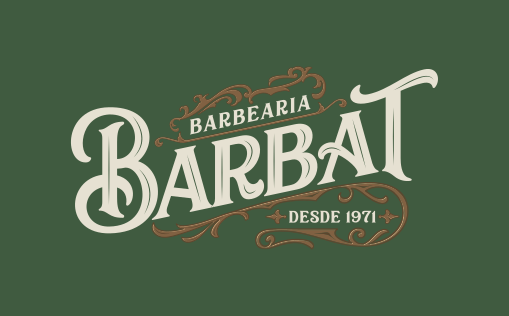

# Barbat Barbearia — Site Institucional

Site institucional da **Barbat Barbearia**, barbearia premium localizada no Tucuruvi, zona norte de São Paulo, com tradição desde 1971.



## 🔗 Deploy

> Em breve — domínio a confirmar

## 📋 Sobre o projeto

Este projeto foi desenvolvido como parte do portfólio de **Victor Odaguiri**, estudante de Sistemas de Informação pela EACH-USP, em transição de carreira para a área de tecnologia.

O site foi construído com auxílio da ferramenta [Lovable](https://lovable.dev) e tem como objetivo aumentar a visibilidade online da Barbat Barbearia, facilitando o agendamento de clientes e a descoberta do negócio em buscas locais.

## ✨ Funcionalidades

- Navbar fixa com CTA para agendamento via WhatsApp
- Hero section com foto profissional e chamada para ação
- Seção de diferenciais da barbearia
- Seção de serviços direcionando para o app oficial
- Seção do app Barbat com links para App Store e Google Play
- Galeria de fotos do espaço
- Mapa embedded com localização e horários de funcionamento
- Botão flutuante de WhatsApp em todas as páginas
- Design responsivo (mobile-first)

## 🛠️ Tecnologias

- [React](https://react.dev)
- [TypeScript](https://www.typescriptlang.org)
- [Tailwind CSS](https://tailwindcss.com)
- [TanStack Start](https://tanstack.com/start)
- [Vite](https://vitejs.dev)
- [Lovable](https://lovable.dev) — geração assistida por IA

## 🎨 Identidade Visual

A identidade visual segue o manual oficial da Barbat Barbearia:

| Cor | Hex |
|-----|-----|
| Verde escuro | `#405B40` |
| Creme | `#F3E3CC` |
| Dourado | `#CAA076` |
| Marrom escuro | `#2F261E` |

**Tipografia:** Playfair Display (títulos) · Source Sans 3 (corpo)

## 🚀 Rodando localmente

Pré-requisitos: [Node.js](https://nodejs.org) (v18+) e npm.

```bash
git clone https://github.com/victorodg/barbat-legacy-site.git
cd barbat-legacy-site
npm install
npm run dev
```

Acesse em `http://localhost:5173`

## 📱 App Barbat

A barbearia possui um app oficial para agendamento:

- [App Store](https://apps.apple.com/br/app/barbat-barbearia/id6468892274)
- [Google Play](https://play.google.com/store/apps/details?id=br.com.starapp.barbatbarbearia&hl=pt)

## 📍 Informações de contato

**Endereço:** Av. Nova Cantareira, 2768 - Lj 07 - Tucuruvi, São Paulo - SP, 02341-000  
**Horários:** Seg–Sex: 10h às 20h | Sáb: 9h às 19h  
**WhatsApp:** [(11) 98871-8260](https://wa.me/5511988718260)  
**Instagram:** [@barbeariabarbat](https://instagram.com/barbeariabarbat)

---

Desenvolvido por [Victor Odaguiri](https://github.com/victorodg)
